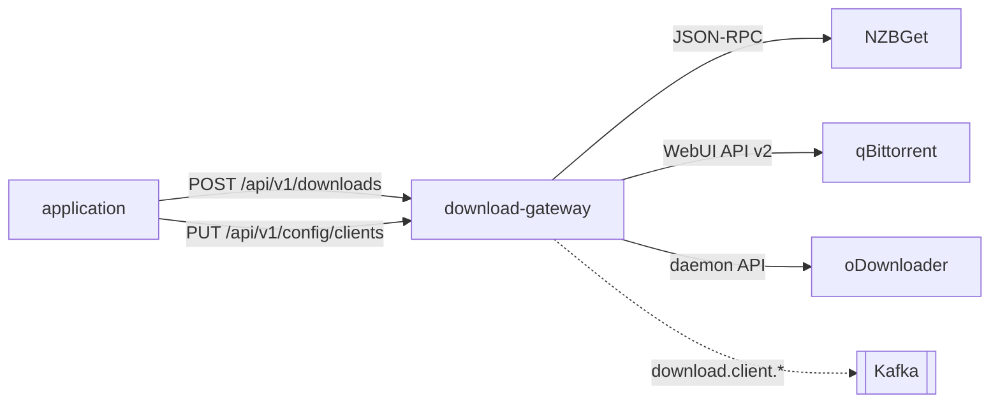

# download-gateway

A small Go service that puts **one API and one event stream** in front of the
download clients you already run. The application that wants something
downloaded talks only to the gateway; the gateway talks to the clients, tracks
every job until it finishes, and publishes the lifecycle as events.



The download clients are **external endpoints**. Nothing in this repository
deploys or bundles them: the gateway is configured with where they are and how
to authenticate, and that is all it needs.

## Clients

A *client* is one configured instance of a compiled-in adapter type. A client
has an id (`^[a-z0-9][a-z0-9-]{0,39}$`, fixed for its lifetime) and the job ids
it hands out are only meaningful together with that client id.

| Type | Protocols | Auth | Payload | Save path | Pause |
|---|---|---|---|---|---|
| `nzbget` | `usenet` | `basic`, `none` | NZB content via `append` | — (the client's category decides) | yes |
| `qbittorrent` | `torrent` | `basic`, `none` | `.torrent` as a multipart `torrents` file | yes | yes |
| `odownloader` | `http` | `token`, `none` | refused | — | — |

- **NZBGet** `append` always sends `DupeMode=FORCE`: an empty DupeMode is an
  invalid enum, and a requested item must never be silently deduplicated away.
  Jobs in the client's category are re-adopted after a restart.
- **qBittorrent** returns no id from `torrents/add`, so every add carries a
  unique `dlg-…` tag that becomes the job id. Removing a job never deletes files.
- **oDownloader** takes hoster links; one add is one package.

Clients come from two places:

- **Environment** (`NZBGET_*`, `QBITTORRENT_*`, `ODOWNLOADER_*`, see
  [Configuration](#configuration)). Each gets the type name as its id and is
  reported with `"source": "env"`. The API can neither replace nor remove them.
- **Pushed configuration** (`PUT /api/v1/config/clients`). The owning
  application keeps the configuration, secrets included, in its own store and
  pushes the full set; the gateway holds it in memory only. After a restart the
  gateway reports revision `0` and the owner pushes again.

## HTTP API

| Method | Path | Purpose |
|---|---|---|
| `GET` | `/healthz` | liveness |
| `GET` | `/readyz` | readiness: the process and the event publisher are up (zero clients is still ready) |
| `GET` | `/metrics` | Prometheus |
| `GET` | `/api/v1/clients` | ids of the clients that accept new downloads |
| `GET` | `/api/v1/clients/status` | per-client health and throughput (`id`, `type`, `reachable`, speeds, detail) |
| `POST` | `/api/v1/downloads` | add a download → `202 {adapter, client, client_job_id}` |
| `GET` | `/api/v1/downloads` | tracked in-flight jobs with their last snapshot |
| `DELETE` | `/api/v1/downloads/{client}/{id}` | remove a job from its client (qBittorrent keeps the files) |
| `POST` | `/api/v1/downloads/{client}/{id}/pause` · `/resume` | pause or resume, where the type supports it |
| `GET` | `/api/v1/config/types` | the adapter types a client can be created from |
| `GET` | `/api/v1/config/clients` | `{revision, clients}` — every client, never a secret |
| `PUT` | `/api/v1/config/clients` | atomically replace every pushed client |
| `POST` | `/api/v1/config/clients/test` | probe one client without registering it |

### Adding a download

```json
{
  "client": "usenet",
  "title": "Example Title",
  "wanted_item_id": "w_123",
  "payload_b64": "PD94bWwgdmVyc2lvbj0iMS4wIj8+…",
  "payload_name": "Example.Title.nzb"
}
```

- `client` names a client id; `adapter` is an accepted alias.
- Send either `source` (a URL, magnet or hoster link the client fetches itself)
  or `payload_b64` (the NZB or `.torrent` file content). With a payload the
  client never sees the link — or any key embedded in it. A client type that
  cannot take a payload answers `400`.
- `save_path` and `category` default to the client's `savePath` and `category`.
- The body is capped at 64 MiB. An unknown client is `404`, a client that a push
  removed while it still has jobs is `409`, a client error is `502`.

`wanted_item_id` is stamped onto the job and echoed on the `completed` event so
the caller maps a finished download back to its request.

### Configuring clients

`GET /api/v1/config/types`:

```json
[{"type":"nzbget","protocols":["usenet"],"auth":["basic","none"],
  "acceptsPayload":true,"supportsSavePath":false,"canPause":true}, …]
```

`PUT /api/v1/config/clients`:

```json
{
  "revision": 12,
  "clients": [
    {"id": "usenet", "type": "nzbget", "baseUrl": "http://nzbget:6789",
     "auth": "basic", "username": "gateway", "secret": "…",
     "category": "downloads", "savePath": "", "protocols": ["usenet"]}
  ]
}
```

→ `200 {"revision": 12, "applied": ["usenet"], "errors": [{"id": "…", "message": "…"}]}`

- The push replaces **all** pushed clients at once. Clients are diffed by id
  and a hash of their settings: an unchanged client keeps running with its
  session, a changed or new one is (re)built and its running jobs are adopted.
- A client missing from the push is removed. If jobs are still tracked on it,
  it keeps being polled until they finish or are lost, but accepts no new adds.
- Errors are per client: an invalid entry, a duplicate id, or an id owned by an
  environment client is reported and not applied. A client already running
  under that id stays as it was.
- `revision` (in the response and in `GET`) is the last revision that applied
  without errors. The valid entries of a push with errors still take effect,
  but the previous revision stays in place, so the owner can tell from `GET`
  alone that its configuration is not fully in effect and push again.
- `secret` is write-only. `GET /api/v1/config/clients` reports `secretSet`
  instead, and secrets never appear in logs.
- Pushed clients, and the clients built by the test endpoint, never connect to
  a link-local or cloud metadata address (`169.254.0.0/16`, `fe80::/10`,
  `100.100.100.200`, `fd00:ec2::254`). The check runs on the resolved address
  at connect time, so a name that later resolves there is refused too. They
  follow a redirect only within their own scheme and host, and they ignore
  proxy environment variables. Environment clients are built as before.

`POST /api/v1/config/clients/test` takes one client object (the id is optional)
and answers `200 {"reachable", "version", "error", "status"}`; a spec that does
not validate is answered the same way with the reason in `error`. Errors name
the HTTP status the endpoint answered with, never the body text it sent, and
are at most 256 bytes. Client responses are read up to 1 MiB (32 MiB for job
and history lists); anything larger is an error.

### Authentication

| `OIDC_ISSUER` | `ALLOWED_CLIENTS` | `/api/v1/*` | `/api/v1/config/*` |
|---|---|---|---|
| unset | — | unauthenticated | `404` |
| set | unset | any valid bearer from the issuer | `404` |
| set | set | a valid bearer whose `azp` (or `client_id`) is listed, else `403` | enabled |

Pushing configuration points the gateway at arbitrary endpoints, so the config
API only exists when callers are restricted to named clients. Token validation
is lazy and self-healing: the gateway recovers on its own when the issuer comes
up.

## Events

A poll loop describes each tracked job (`POLL_INTERVAL`, default `5s`) and
publishes JSON to Kafka over mTLS on `<KAFKA_TOPIC_PREFIX>download.client.<kind>`:

| Kind | When | Carries |
|---|---|---|
| `started` | an add succeeded | `wanted_item_id`, title |
| `progress` | each poll while running | state, native state, %, bytes, speed, ETA, peers or health |
| `completed` | the client reports completion | `wanted_item_id`, `files[]`, size |
| `failed` | the client reports failure, or the job vanished for 10 minutes | `error` |

Every event has `client_id` (the client's job id), `adapter` (the client id —
for environment clients still the type name) and `client_type`. Without Kafka
the publisher runs in log-only mode and the service stays ready.

## Configuration

| Env | Default | Purpose |
|---|---|---|
| `DOWNLOAD_GATEWAY_ADDR` | `:8080` | listen address |
| `POLL_INTERVAL` | `5s` | job poll cadence |
| `OIDC_ISSUER` | — | require bearer tokens from this issuer |
| `ALLOWED_CLIENTS` | — | comma list of OIDC client ids allowed to call; enables the config API |
| `KAFKA_BROKERS` | — | bootstrap servers (TLS listener) |
| `KAFKA_TLS_CERT` / `KAFKA_TLS_KEY` / `KAFKA_TLS_CA` | — | mTLS material |
| `KAFKA_TOPIC_PREFIX` | `stube.` | topic namespace |
| `NZBGET_URL` / `NZBGET_USER` / `NZBGET_PASS` / `NZBGET_CATEGORY` | — | environment client `nzbget` |
| `QBITTORRENT_BASE_URL` / `QBITTORRENT_USER` / `QBITTORRENT_PASS` | — | environment client `qbittorrent` |
| `ODOWNLOADER_BASE_URL` / `ODOWNLOADER_TOKEN` | — | environment client `odownloader` |

## Development

```bash
go run ./cmd/server
curl localhost:8080/readyz
go test -race ./...
```

The container image is built from `Dockerfile.ghcr`. Deploying the gateway is
the job of whatever installs the application that uses it.

## License

[MPL-2.0](LICENSE)
